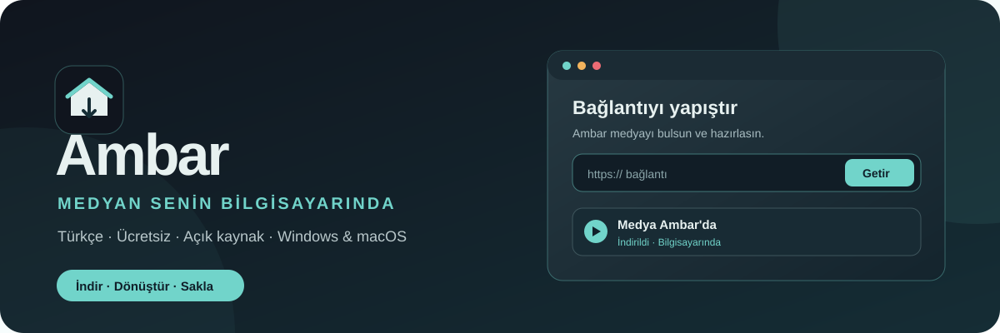
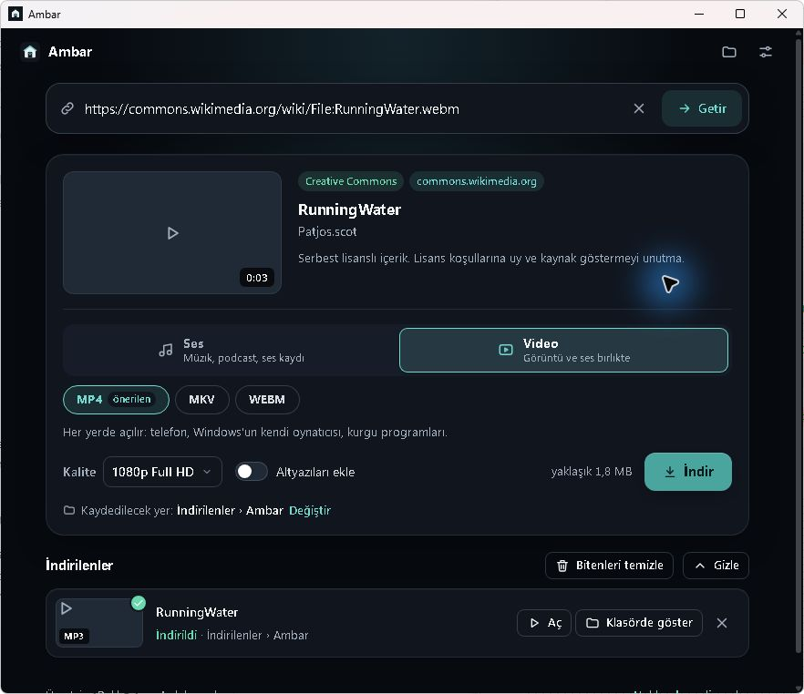
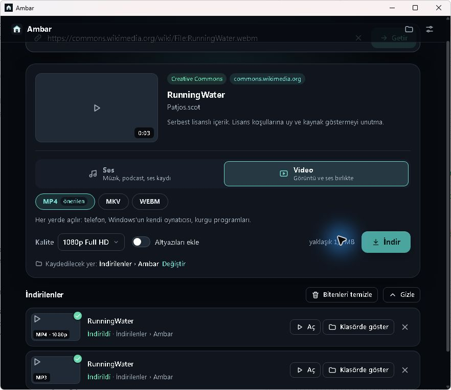
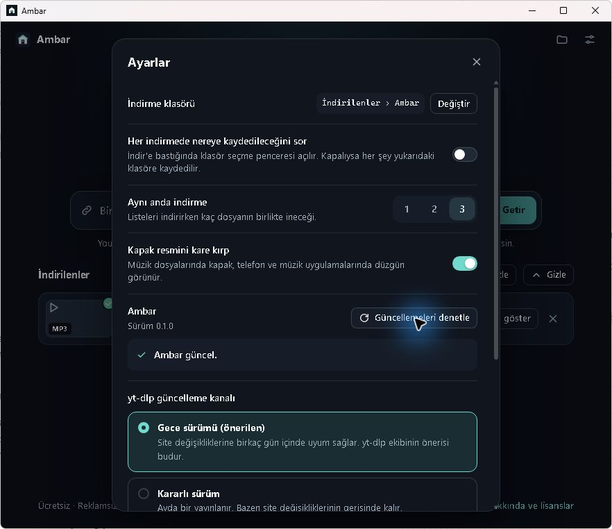

# 📦 Ambar

**Medyan senin bilgisayarında.** Bağlantıyı yapıştır, biçimi seç, indir. Ambar; video ve ses içeriklerini bilgisayarına kaydetmek için hazırlanmış, Türkçe, ücretsiz ve açık kaynak bir masaüstü uygulamasıdır.

[⬇️ Son sürümü indir](https://github.com/anilcanolcer/ambar/releases/latest) · [🌐 Ölçer Web Tasarım](https://olcerwebtasarim.com/) · [📋 Sorun bildir](https://github.com/anilcanolcer/ambar/issues)

## ✨ Proje özeti & vizyonu

Ambar, [Anılcan Ölçer](https://github.com/anilcanolcer) tarafından geliştirilen ve sürdürülen bir masaüstü medya arşivleme projesidir. [Ölçer Web Tasarım](https://olcerwebtasarim.com/) yaklaşımındaki net arayüz, anlaşılır süreç ve sürdürülebilir bakım fikrini küçük bir kişisel araca taşıyoruz: hangi dosyanın nereye kaydedileceği açık olsun, kullanılan bileşenler görülebilsin ve yeni sürümler güvenli biçimde ulaşsın.

Vizyonumuz, izinli içeriklerini toplamak isteyen herkesin karmaşık komutlarla uğraşmadan kendi bilgisayarında düzenli bir arşiv kurabilmesi. Ambar'ın altyapısı MIT lisanslı [Kova](https://github.com/alpunlu12-commits/kova) kaynak kodundan geliştirilmiştir. Kaynak proje ve diğer açık kaynak bileşenlerin atıfları aşağıdadır.

| | Ambar'da neler var? |
| --- | --- |
| 🔗 **Önizleme** | Bağlantıdaki medyanın adı, süresi ve varsa kapak bilgisi |
| 🎵 **Ses** | MP3, M4A, OPUS, FLAC ve WAV seçenekleri |
| 🎬 **Video** | MP4, MKV ve WEBM seçenekleri; kalite seçimi |
| 📚 **Düzen** | İndirme kuyruğu, geçmiş, klasör seçimi ve oynatma listeleri |
| 🧰 **Bileşenler** | yt-dlp, FFmpeg ve Deno sürümlerini uygulama içinden yönetme |
| 🔐 **Güncelleme** | GitHub Releases üzerinden imzalı Ambar sürümlerini denetleme ve kurma |

Kaynak siteye ve içerik türüne göre kullanılabilen özellikler değişebilir. Yalnızca indirme hakkına sahip olduğun içerikleri kullan.

## 🖼️ Uygulamadan görüntüler

Gerçek Windows kurulumundan alınmıştır. Önizleme ve dönüşüm örneğinde [Wikimedia Commons'taki RunningWater](https://commons.wikimedia.org/wiki/File:RunningWater.webm) kullanıldı.



| İndirme geçmişi | Güncelleme denetimi |
| --- | --- |
|  |  |

## 🚀 Kurulum ve kullanım

1. [Son sürüm](https://github.com/anilcanolcer/ambar/releases/latest) sayfasından Windows için **`Ambar_…_x64-setup.exe`**, macOS için **`Ambar_…_universal.dmg`** dosyasını indir.
2. Uygulamayı kur ve aç. İlk kullanımda Ambar, yt-dlp, FFmpeg ve Deno bileşenlerini kendi kaynaklarından indirip doğrulamak için senden onay ister.
3. İndirme hakkına sahip olduğun bağlantıyı yapıştır ve **Getir** düğmesine bas.
4. **Ses** veya **Video** biçimini, varsa kalite ve altyazı seçeneklerini seç; **İndir** düğmesine bas.
5. Sonuçları **İndirilenler** bölümünden aç veya klasörde göster.

İlk imzalı sürüm olan **0.1.0** öncesindeki deneme kurulumu güncelleme anahtarını içermez. Deneme kurulumunu kullananların [son kurulum dosyasını](https://github.com/anilcanolcer/ambar/releases/latest) **bir kez elle kurması gerekir**.

## 🔄 Uygulama nasıl güncellenir?

Ambar yalnızca bu deponun imzalı GitHub sürümlerini kabul eder. Yeni kod `main` dalına eklendiğinde GitHub Actions yeni sürüm numarasıyla Windows ve macOS paketlerini oluşturur; iki platform ve `latest.json` doğrulanırsa sürümü yayımlar. Derleme başarısızsa sürüm yayımlanmaz.

**0.1.0** sürümü güncellemeyi uygulama açıldıktan sonra denetler ve **Güncelle** düğmesini gösterir. Sonraki sürümler güncellemeyi ana ekran açılmadan önce denetleyip mevcutsa indirir, imzasını doğrular, kurar ve yeni sürümü açar. İnternet bağlantısı yoksa uygulama mevcut sürümle devam eder. Kurulum hata verirse **Tekrar dene** ve **Eski sürümü aç** seçenekleri bulunur.

Tauri güncelleme imzası, Windows/macOS işletim sistemi kod imzalama sertifikasıyla aynı şey değildir. İşletim sistemi yayıncısı doğrulanamadı uyarısı gösterebilir.

## ✅ Doğrulananlar

- Windows imzalı **0.1.0** kurulumu açıldı; uygulama içindeki denetim **“Ambar güncel”** sonucunu verdi.
- Wikimedia Commons örneği MP3 ve MP4 olarak indirildi. MP4 dosyası H.264 video ve AAC ses içeriyor; FFmpeg ile hatasız çözümlendi.
- Windows ve macOS imzalı paketleri GitHub Actions'da üretildi; `latest.json` her iki platformun imzalarını içeriyor.
- macOS kurulumu bu Windows bilgisayarda çalıştırılamadığı için macOS kullanım testi henüz yapılmadı. Açılışta otomatik yükseltme, bir sonraki yayınla birlikte gerçek bir eski sürümden sınanacak.

Kısa bir örneğin süresi veya hızı, farklı sitelerdeki indirme ve dönüşüm performansı için genel garanti değildir.

## 🛠️ Kaynaktan geliştirme

Node.js, npm, Rust ve [Tauri 2 ön koşulları](https://v2.tauri.app/start/prerequisites/) gerekir. Windows'ta Visual Studio C++ Build Tools ve WebView2 de gereklidir.

```sh
npm ci
npm run app
npm run app:build
```

İmzalama anahtarı depoya eklenmez. GitHub Actions'ta `AMBAR_UPDATER_PUBLIC_KEY` değişkeni ve `TAURI_SIGNING_PRIVATE_KEY` gizli anahtarı tanımlanır. Özel anahtar kaybolursa var olan kurulumlara güvenilir güncelleme gönderilemez.

## 🤝 Kaynak ve lisans

Ambar, Anılcan Ölçer'in markası ve geliştirmesiyle sürdürülür. Başlangıç kod tabanı [Kova](https://github.com/alpunlu12-commits/kova) projesidir; orijinal telif bildirimi ve MIT lisansı [LICENSE](LICENSE) dosyasında korunur. yt-dlp, FFmpeg, Deno, Tauri ve diğer bağımlılıkların kendi lisansları geçerlidir.
